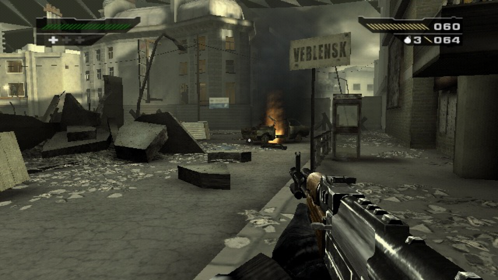

# black-recomp



Veblensk rodando nativo no Mac.

## O que é

Isso aqui é uma tentativa de rodar o **Black** (PS2, EA/Criterion) nativo no Mac, sem emulador.

A ideia é recompilar o código do jogo pra ARM64 usando o [PS2Recomp](https://github.com/ran-j/PS2Recomp) do ran-j. O resto (gráficos, vídeo, som, controle) fica por conta do runtime do PS2Recomp, com um monte de correções minhas.

Só funciona no macOS com Apple Silicon (testei num M1 Pro).

**Não tem nenhum arquivo do jogo aqui.** Nada de ISO, ELF, BIOS, textura, microcódigo ou código gerado a partir do jogo. Pra rodar você precisa da sua própria cópia do Black. Os scripts não usam BIOS, só os arquivos do seu disco.

## Quanto falta pra ser um recomp bom de jogar

**Leitura de hoje (2026-10-13): uns 72%.** A meta é jogar o Black no PC com gráfico bom e 60 fps de verdade (o jogo gerando 60 quadros, não acelerado). É um chute, mas é assim que eu chego nele:

| pedaço da meta | peso | onde tá | por quê |
|---|---|---|---|
| Rodar sem travar nem corromper | 25% | ~80% | O congelamento aleatório foi achado e corrigido (era um desvio de 64 bits traduzido errado). A falha esporádica de abertura de arquivo não reproduz mais. |
| Gráfico bom | 25% | ~75% | O renderizador Metal é o padrão, bate com a referência (0,01–0,22% de pixels diferentes) e roda em 3× com 16:9. Fumaça, fogo e brilho foram corrigidos. Falta o reflexo das armas, que aparece com triângulos brancos (bug em aberto, antes do GS). |
| 60 fps de verdade | 25% | ~85% | 60 ticks é o padrão (o jogo gera 60 quadros, não acelera). Os quadros são apresentados no flip do próprio jogo e o vblank do jogo segue a tela (CVDisplayLink, 120 Hz → um vblank a cada 2 atualizações da tela): nas medições de jogo, 0 quadros atrasados na tela. A GPU leva ~8 ms por quadro em 3× no ponto pesado (0 de 120 acima de 16 ms). Falta revisar as poucas constantes do jogo que assumem 30 Hz e medir nas outras fases. |
| Jogo inteiro, som, save | 25% | ~65% | O jogo roda bem além do Level_00 (~80%), som funcionando (SPU2 sintetizado, com reverb), mouse e teclado como num FPS de PC. Memory card ainda não foi testado. |

Somando com os pesos dá ~76%; eu puxo pra ~72% porque ainda há bugs em aberto (reflexo das armas, tiros abafados), o save não foi testado e só roda em Mac com Apple Silicon.

## Progresso por parte

Chute meu, com base no que já foi testado. Não é uma métrica oficial.

| parte | % | por quê |
|---|---|---|
| EE (CPU principal) | ~88% | Roda o Level_00 inteiro. 2.557 instruções do jogo testadas contra um modelo independente, 0 diferenças. O travamento era daqui (`bltz/bgez/blez/bgtz` testavam 32 bits em vez de 64) e foi corrigido. Faltam algumas instruções sem teste. |
| VU1 | ~88% | 99,9% dos pares em blocos NEON nativos, 1,6–1,7 ns por par nos traces gravados (~2× o PS2, medido sem o custo do próprio banco de teste), 0 divergências. Código gerado em 8 arquivos, com superblocos guiados por perfil dos traces. A meta de 1,5 ns ainda não foi atingida; dividir entre núcleos só com execução especulativa (medido, não feito). |
| VU0 | ~88% | Mesmo gerador da VU1, 99,7% dos pares em código direto, ~1,5–2,3 ns por par contra 3,39 ns do console. No modo macro (instruções COP2 dentro do código do EE) foram corrigidas `VDIV/VSQRT/VRSQRT`, `VFTOI` (estourava para negativo em vez de saturar) e `VMAX/VMINI` (agora comparam como a VU, bit a bit). |
| IOP | ~95% | Os 10 módulos que o jogo carrega estão recompilados (nenhum módulo novo apareceu jogando além do Level_00). A CPU passa num teste diferencial contra um modelo independente do R3000: 8.257 instruções distintas dos módulos, 0 diferenças, incluindo o load delay (corrigido o `LWL`/`LWR`, usado pelos drivers de controle e memory card). Roda em thread própria. Falta testar salvar/carregar. |
| GS com paraLLEl-GS (referência) | ~85% | Texturas e imagem certas; usado como referência pra validar o Metal (`BLACK_GS=parallel`). Lento no ponto mais pesado. |
| GS nativo em Metal (padrão) | ~85% | Bate com o paraLLEl-GS em 6 dumps (0–0,22% de pixels diferentes). Desenha direto na janela, sincronizado com a tela, de 1× a 8× de resolução interna; shaders especializados por estado (3×: ~4,4 ms por quadro no replay). |
| Vídeos (FMV) | ~85% | Tocam e dá pra pular. |
| Controle | ~90% | Controle, teclado e mouse funcionam juntos. O mouse gira a câmera direto no ângulo do jogador (sem a aceleração do analógico), como num FPS de PC. |
| Disco/arquivos | ~95% | Carrega tudo do disco. A falha esporádica de abertura de arquivo não reproduz mais (4 boots, ~240 aberturas, nenhuma falha); `BLACK_DEBUG=1` registra cada abertura (`[black-fs]`) se voltar. |
| Áudio | ~70% | O SPU2 agora sintetiza o som de verdade: ADPCM, interpolação gaussiana do hardware, envelopes, volumes, reverb, a entrada de PCM que o driver do jogo mistura no IOP e a saída de cada núcleo na RAM de som. Vozes, rádio e recargas ok; os tiros ainda saem um pouco abafados comparando com o PCSX2. |
| Memory card/save | ? | Passa pelo aviso do memory card, salvar ainda não foi testado. |
| 60 fps | ~85% | 60 constante no Level_00, inclusive no ponto pesado e nas explosões (as quedas vinham de cópias de alvo na GPU e da apresentação fora do flip, ambas corrigidas). Thread do jogo em ~22% no ponto pesado. Falta revisar o que no jogo assume 30 Hz e testar as outras fases. |
| Tradução pt-BR | em andamento | Os textos do jogo (`MAINUS.BIN`, 1.716 entradas) têm uma versão em português, sem acentos por enquanto (a fonte do jogo só tem ASCII). O launcher abre em português por padrão. Revisão do texto ainda em curso; só foi testada no começo do jogo. |
| Jogo inteiro | ~80% | O jogo roda bem além do Level_00 (avaliação jogando). Falta fechar os bugs em aberto e testar o save. |

## Até onde chegou

- O jogo abre, passa pelo menu, toca os vídeos e chega na primeira fase (Level_00). Já dá pra andar pelas ruas de Veblensk (a foto aí em cima).
- **A sala do começo tá inteira.** As paredes, o teto e as janelas que sumiam eram o VF0 zerado nas threads secundárias. Corrigido, e o jogador não fica mais preso.
- **Geometria que sumia conforme a câmera também foi resolvida.** Era o arredondamento do EE (o PS2 trunca) e uns stalls de pipeline da VU que faltavam.
- **Nada do console é interpretado no caminho normal:** EE, VU0, VU1 e IOP rodam recompilados.
- **A VU1 já é mais rápida que a do PS2.** Os microprogramas viram blocos NEON nativos (99,9% dos pares de instrução rodam assim). No replay de traces gravados do jogo dá ~1,6–1,7 ns por par, contra ~3,4 ns no chip de verdade, ou seja, ~2× mais rápida que o console, com 0 divergências contra a referência.
- A VU0 usa o mesmo gerador e agora também passa o console: ~2,0 ns por par em jogo (uma chamada de microprograma leva ~100 ns). A thread do jogo roda no mesmo modo de ponto flutuante da VU (arredonda para zero, sem denormais, como o EE de verdade), então a chamada não troca de modo.
- O microcódigo da VU sai direto do seu ELF na hora do build. Nada disso vem no repo.
- **60 fps de verdade, por padrão.** `BLACK_TICK_RATE=60` é o padrão do launcher: o jogo roda a lógica a 60 atualizações por segundo e gera 60 quadros (`BLACK_TICK_RATE=30` volta ao ritmo original). Os timers do jogo contam ticks, então quando uma atualização pega mais de um vblank os ticks extras são somados ao contador, e o vídeo do menu avança pelo tempo real.
- O que ajudou a chegar aí: espera do vblank sem gastar CPU, UNPACK do VIF1 mais rápido, 8 contextos de quadro no Granite (paraLLEl-GS) e as otimizações da VU.
- **Num ponto bem pesado** (olhando pela janela, ~117 mil primitivos por quadro) o paraLLEl-GS segura em ~36 a 60 ticks.
- **Renderizador nativo em Metal** (`gpu/native/`, padrão do launcher; `BLACK_GS=parallel` volta ao paraLLEl-GS). Desenha direto na janela, apresenta no flip do jogo e aceita resolução interna maior (`BLACK_GS_SCALE`, padrão 3). Todos os alvos são ampliados (os buffers de efeito usam um filtro de caixa pra manter o borrão sem virar escada). Com os shaders especializados por estado (Metal function constants, compilados em segundo plano), o quadro pesado em 16:9 caiu de 7,5 pra 4,4 ms em 3× no replay. Detalhes em [GS_NATIVE_RENDERER_PLAN.md](GS_NATIVE_RENDERER_PLAN.md).
- **O céu aparece no renderizador Metal.** O jogo desenha as nuvens uma vez no carregamento e desenha as próprias paletas com triângulos; o renderizador agora acompanha isso sem passar pela CPU.
- **Colisões: corrigi a latência da divisão da VU0.** Em dois lugares o jogo lê o resultado da divisão anterior logo depois de começar uma nova; o código recompilado entregava o resultado novo. É o mesmo problema que o PCSX2 corrige com um patch ("fixes broken collisions"). Achei comparando o código na RAM de um savestate do PCSX2 com a nossa.
- **Tradução pra português do Brasil (em andamento).** O arquivo de textos do jogo ganhou uma versão pt-BR, montada por `tools/loc/install.sh` (fica na raiz do projeto, fora deste repo) a partir do arquivo do seu disco; `tools/loc/install.sh --restore` volta o inglês. O jogo só lê esse arquivo quando roda dos arquivos soltos de `recomp/disc`, então o launcher passou a abrir assim por padrão (`BLACK_LANG=en` usa a imagem do disco, em inglês). Sem acentos ainda.
- **IOP em thread própria, por padrão** (`BLACK_IOP_THREAD=0` volta à thread do jogo). Tira o IOP da thread do jogo (de ~12% pra ~1,5% dela) e, desde que o SPU2 passou a sintetizar o som, funciona com áudio.
- **O jogo não dispara mais acima de 60 depois de um trecho lento.** O relógio de vblank "devia" o tempo perdido e os vblanks seguintes chegavam colados; agora o atraso é descartado.
- **Registro de engasgos sem perfilador.** O launcher grava em `recomp/diagnostics/hitches.log` as janelas de 2 s com atualização lenta e, do lado da GPU, quantos quadros chegaram atrasados à tela (medido pelo `presentedTime` do Metal, que é o que a gente vê). (O perfilador `sample` do macOS derruba o jogo pra 30–45 enquanto roda.)
- **Thread da VU1 mais leve.** Saíram cópias e uma varredura de pacotes que eram ~18% dela; hoje ~71% do tempo dela é o código dos microprogramas.
- **O travamento aleatório foi resolvido.** Era um erro do tradutor da EE: `bltz/bgez/blez/bgtz` testavam só 32 bits e o PS2 testa 64. Uma travessia de grafo do jogo nunca terminava, estourava a pilha dela e sobrescrevia a fila de desenho. Achei com um ponto de vigia no depurador (`BLACK_WATCH=1`). Depois da correção o tutorial do começo da fase ("PRESS R1 TO FIRE WEAPON") passou a aparecer, o que não acontecia antes.
- **Som (2026-10-12).** O SPU2 do IOP só simulava o tempo das vozes; agora mixa de verdade, seguindo o roteamento do hardware (o Black lê de volta a saída de um núcleo, processa no IOP e devolve como PCM). Sai num stream de 48 kHz com reamostragem cúbica que acompanha a diferença de 0,4% entre o relógio do jogo e o do Mac.
- **Mouse e teclado como no PC (2026-10-12).** Clica na janela pra capturar o mouse (F1 solta). O mouse escreve o yaw/pitch do jogador direto (`BLACK_MOUSE_SENS`, `BLACK_MOUSE_INVERT`), botão esquerdo atira, direito mira, roda troca de arma.
- **VU0 no modo macro mais fiel (2026-10-12/13).** Conversões para inteiro que estouravam viravam números negativos (vértices voando, o "SPS" que o PCSX2 trata com um modo especial de clamp pro Black); max/min trocavam máscaras inteiras por NaN; raiz/divisão por zero davam 0. Corrigido no tradutor e no código gerado.
- **Ferramentas de diagnóstico novas.** `GravarCena.command` + F9 gravam o GS no ponto que você estiver; `diagnostics/gs_prims.py` lista os vértices de um dump nosso ou de um GS dump do PCSX2; o trace da VU1 pode começar por arquivo-gatilho (`PS2X_VU_TRACE_REQUEST`) e o replay exporta os pacotes (`--packets`).
- 16:9 com `BLACK_WIDESCREEN=1`. Dá pra pular vídeo com Tab ou Select. Teclado e controle funcionam (veja [CONTROLES.md](CONTROLES.md)).

## O que falta

Ainda não dá pra jogar de verdade.

- Reflexo das armas com triângulos brancos (a passada de reflexo recebe coordenadas fora de [0,1] da VU1; o PCSX2 recebe dentro). Investigação em [PS2_PROJECT_STATE.md](PS2_PROJECT_STATE.md).
- Tiros um pouco abafados em relação ao PCSX2.
- Tradução: sem acentos, revisão em curso, e só o começo do jogo foi visto em português.
- As correções dos desvios de 64 bits e da divisão da VU0 mexem na lógica do jogo inteiro: falta rever jogando os sintomas antigos de comportamento (chão perto da porta, objetos que faltavam).
- Chão liso ou com buracos perto da porta da sala inicial. Ainda investigando.
- Alta resolução no paraLLEl-GS continua quebrada (no Metal, que é o padrão, funciona).

## Próximos passos

- VU de "alto nível" de verdade: a VU1 ainda está em ~1,6 ns por par (meta: 1,5); na VU0 o que pesa é o custo fixo de cada chamada (programas de ~49 pares).
- Fechar o bug do reflexo das armas; levar o max/min exato também pro modo micro da VU (interpretador + gerador); baixar o custo fixo de cada chamada da VU0.
- Pra mirar 120 quadros reais: dividir a VU1 entre núcleos (precisa de execução especulativa) e baixar o tempo do EE (as chamadas diretas já ficaram inline; falta um benchmark determinístico do EE pra medir ganhos de 1–5%).
- Testar o jogo inteiro.
- Um `setup.sh` pra montar tudo de uma vez.

Os detalhes técnicos de verdade estão em [PS2_PROJECT_STATE.md](PS2_PROJECT_STATE.md).

## Como rodar

Os scripts esperam esse repo numa pasta `ps2recomp/`, ao lado do PS2Recomp e dos seus arquivos do jogo:

```
pasta/
├── ps2recomp/          # esse repo
├── tools/PS2Recomp/    # PS2Recomp no commit 75d729c
├── orig/SLUS_213.76    # ELF do seu disco
├── orig/Black.iso      # ISO do seu disco
└── recomp/disc/        # arquivos extraídos do seu disco
```

1. Clona esse repo: `git clone https://github.com/SirBraga/black-recomp.git ps2recomp`
2. Clona o PS2Recomp e volta pro commit certo (não aplica patch na mão, o `build.sh` aplica o `patches/0001-black-runtime-fixes.patch` sozinho):
   ```sh
   git clone https://github.com/ran-j/PS2Recomp.git tools/PS2Recomp
   git -C tools/PS2Recomp checkout 75d729c
   ```
3. Coloca os arquivos do seu disco em `orig/` e `recomp/disc/`. Vai precisar de CMake, Ninja (em `.venv/bin/ninja`), Python 3 e SDL3 (Homebrew).
4. Compila o jogo: `ps2recomp/build.sh`
5. Gera a VU a partir do seu ELF: `ps2recomp/build_vu_recompiled.sh` (demora uns 20 min)
6. Opcional: `ps2recomp/gpu/build.sh` pro paraLLEl-GS e pro renderizador Metal (o paraLLEl-GS precisa do MoltenVK em `recomp/gpu/moltenvk/`)
7. Joga: abre o `ps2recomp/JogarBlack.command` (abre em português se você rodou o `tools/loc/install.sh`; `BLACK_LANG=en` pra inglês; por padrão já abre em português, 16:9, renderizador Metal em 3× e 60 Hz; `BLACK_GS_SCALE=4` sobe a resolução, `BLACK_WIDESCREEN=0` volta pra 4:3, `BLACK_TICK_RATE=30` pro ritmo original, `BLACK_IOP_THREAD=0` põe o IOP de volta na thread do jogo, `PS2X_SPU2_AUDIO=0` desliga o som novo, `PS2X_MOUSE_LOOK=0` desliga o mouse)
8. Depois da primeira vez, roda `ps2recomp/build_iop_recompiled.sh` pra recompilar o IOP com os módulos que o launcher salvou

## Créditos

- [PS2Recomp](https://github.com/ran-j/PS2Recomp), do ran-j e contribuidores. Tudo aqui é em cima dele, e o patch segue a licença dele (GPL-3.0).
- SDL3, Raylib, Dear ImGui, rlImGui, FFmpeg, paraLLEl-GS e MoltenVK.
- PCSX2 e RT64 como referência.

Black é marca da Electronic Arts. Projeto independente, sem ligação com a EA ou a Criterion.
